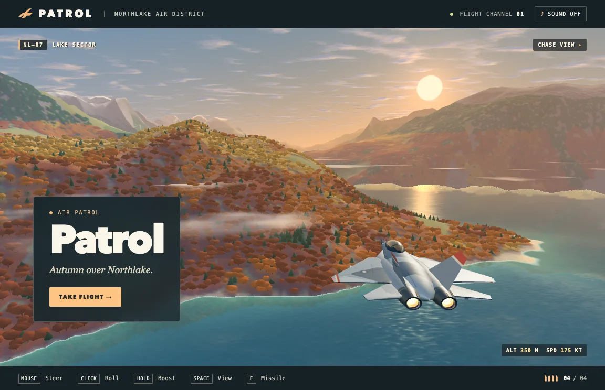

## kinzun 的工作台

我给 Codex 做了个收工铃，也在浏览器里做了一座可以贴着水面飞的秋日湖区。

[去北湖起飞](https://kinzun.github.io/aircraft-patrol/versions/original/) · [下载 Mac 任务通知](https://github.com/kinzun/mac-task-notifier/releases) · [个人博客](https://kinzun.github.io/)

### 北湖机库

**[Aircraft Patrol · 北湖空战](https://github.com/kinzun/aircraft-patrol)** 
从像素湖区的自由巡航，到能看见水面倒影的 3D 版。四个版本都能下载成单个 HTML 文件，断网也能飞。

**[云上奇行 · Wing Rider](https://github.com/kinzun/wing-rider-infinite)** 
在无限赛道上骑行、跳跃，用肩炮迎击蜂群。[试玩云上奇行](https://kinzun.github.io/wing-rider-infinite/)

<code>NL-07</code> · 打开飞行记录

进驾驶舱后按 <kbd>空格</kbd>，试试三个视角。上面这张是追尾视角，左上角就是这段记录的编号。

[飞同一片湖 · 北湖 3D 版](https://kinzun.github.io/aircraft-patrol/versions/3d/)

### 菜单栏与终端

- **[Mac 任务通知](https://github.com/kinzun/mac-task-notifier)** · Codex 跑完后，菜单栏的铃铛下方弹出原生通知，手头的窗口不用切走。
- **[VarGenius](https://github.com/kinzun/VarGenius)** · 在 Alfred 或命令行里丢进去一句需求，拿回一组英文变量名候选。
- **[tantan](https://github.com/kinzun/tantan#readme)** · 用 Python 批量探测 HTTP，记录状态码和耗时，附 Zabbix 配置示例。

[查看全部仓库](https://github.com/kinzun?tab=repositories)

<!--
如果你是从 Raw 翻到这儿的：菜单栏的铃响了，说明 Codex 收工了。
湖面那架飞机还在等你。
-->
